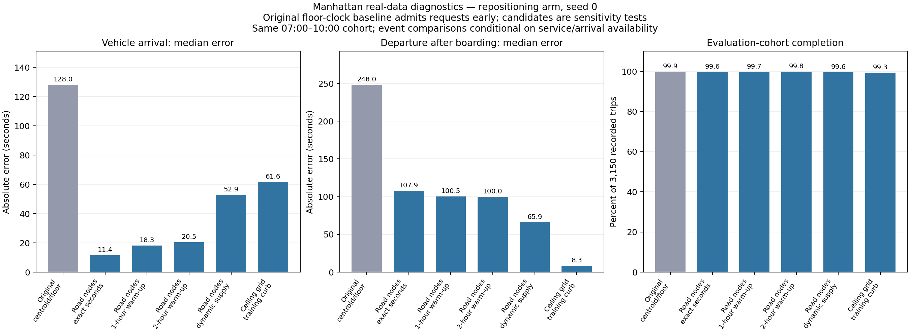

# Real Manhattan investigation

**Historical investigation record:** the production fixes described below are
implemented in the [production follow-up](PHASE_7_COMPLETION.md), which records
the current regression and real-data validation gates. The original source,
inputs, results and failed runs on this page remain unchanged as evidence.

The data is available. The simulator is not yet demonstrated to reproduce the
real market. Successful fixture runs and a completed data pipeline did not
establish real-data calibration. This investigation preserves those earlier
results and tests the reasons for the discrepancy on actual trip records.

## Data and frozen comparison

Public inputs were downloaded after publishing the cloud network allowlist:

- November 2019 TLC HVFHV Parquet: 561,011,664 bytes, 21,635,568 rows;
  SHA256 `b874a6c03589669a6a1d56ef477c536ed13710c4d13adfca35fd1677d9473d50`.
- TUM FleetPy Manhattan archive, Zenodo record 15187906: 408,878,341 bytes;
  SHA256 `d9e86f33645e5eec287d387f8d63ad41ddf41d4ef648138b65d636482e2c599e`.
  Its published MD5 was verified; extraction contains 335 files.
- Official TLC zone lookup: SHA256
  `1a99e105092230f8620f301edcca7f80d3080642ff404d28ed957d3fa222c8ed`.

The supplied network has 4,411 nodes and 63 Manhattan zones. TUM's internal
zone numbers are joined to official TLC LocationIDs through `general_info.csv`.
The projected polygon coordinates are EPSG:32618 despite incorrect CRS84
metadata in that GeoJSON; the separate CRS files agree with the network.
Representative nodes are constrained to their polygons. Raw sources are kept
under `/workspace/market_inputs/`; provenance and verified hashes accompany
the evidence, rather than committing large public binary datasets to Git.

Every experiment uses unchanged simulator source:
`d0dd474cef8aae0ccbd1f5c94008788b02648efb523a167c3bbe11c1722f84da`,
parent commit `fd2a76e5c596944b5a1da177eb65ad3757a222b1`. Input ablations
are separate immutable bundles, with parent hashes and transformation scripts.

The evaluation cohort is the same 3,150 source-row identities from November 26,
2019, 07:00–10:00 New York local time. Training dates are the three earlier
Tuesdays, November 5/12/19. Source sampling is a stable 10% hash sample,
seed 0. All comparisons pair no repositioning with `PavoneFCHiGHS` and verify
matching background input fingerprints within each pair. Parameters include
775 vehicles, assumed utilization 0.58, capacity four unless explicitly
ablated, 30-second boarding and training-fitted travel factors/noise.
These real runs exercise insertion matching. Other controllers and optional
driver-choice features retain their earlier fixture validation; this record
does not claim that they have been calibrated against real Manhattan data.

## Findings and measurement corrections

1. **Requests entered too early.** The market builder floors request timestamps
   to a minute. Against the raw source clock, the original baseline produced
   1,411 pickups before the request without repositioning and 2,031 with it;
   the earliest was 59 seconds early. The original report subtracts rounded
   simulation request time and conceals this discrepancy. Exact-second and
   causal ceiling-grid inputs test alternatives. Source timestamps are retained;
   negative waits are counted, never clipped away.
2. **Centroid co-location.** All origins, destinations and initial vehicle
   locations originally use 63 representative nodes. Repositioning places
   vehicles at these same future pickup nodes. There were 1,273/3,039 and
   1,924/3,147 zero simulation-grid waits in the two baseline arms. Stable,
   source-row-keyed road-node imputation tests this assumption. Uniform road
   placement is a sensitivity assumption, not observed GPS.
3. **Cold start and truncated history.** Full-day training records show about
   156 ongoing recorded rides per training day at 07:00. These are rides, not
   distinct vehicles. The old training filter excludes requests before 07:00.
   Restoring carry-in raises the first-bin modeled supply proxy from 95 to
   309 vehicles under the same utilization assumption. Separate one-/two-hour
   warm-up experiments test initialization while preserving evaluation IDs.
4. **Different events were compared.** FleetPy `pickup_time` is boarding start,
   verified against actual boarding activity. TLC `on_scene_datetime` records
   vehicle arrival; TLC `pickup_datetime` occurs later. For the 1,867 target
   trips with valid arrival records, median arrival wait is 114 seconds and
   median curb time 102 seconds. Those medians do not add to the median total.
   Arrival coverage is only 59.3%, almost entirely one provider. We compare
   arrival on identical available/served identities and separately compare the
   modeled departure after boarding with TLC pickup. No arbitrary curb delay
   is added to force a fit.
5. **Pooling differs.** Target source shared-match share is 20.35%. Baseline
   modeled overlapping-rider shares among served trips are 56.30% without
   repositioning and 42.20% with it. The definitions differ, but the model also
   makes all requests eligible to pool. Capacity-one runs bracket this
   assumption; they are not the observed fleet and cannot establish a fix.
6. **Other limits remain.** Observed completed trips omit cancellations and
   rejected demand; online vehicle exposure is unavailable. Fleet size and
   patience are assumptions. Patience uses observed held-out wait plus 300
   seconds, making this a retrospective replay, not a prospective demand
   prediction. Intrazonal trips remain excluded. Within-bin residual log-noise
   sigma is 0.4721 versus the current global 0.4862; experiments keep existing
   travel factors/noise unchanged to isolate the tested effects.

## Actual results

Across 14 configurations (original plus 13 variants), **27 canonical simulations
were attempted: 24 completed all booked trips, three failed, and one policy arm
was not launched after its setup's first-arm failure**. Eleven complete policy
pairs passed background input validation. The observer replay separately
reproduced one failed run. All pending experiments are finished.

Eight completed floor-clock arms still fail the independent source-clock
causality check. Completion of a simulation does not make it a valid benchmark.
The other 16 completed arms have no pickup before the source request time.
All 24 completed arms pass unique/full demand accounting, accepted completion,
chronological activity, route capacity and boarding-event checks; successful
repositioning arms also have actual audited orders and physical reposition legs.

For the repositioning arm, replacing centroid/floor inputs with imputed road
endpoints/initial positions and exact-second admission gives:

| Metric | Original centroid/floor | Road nodes, exact seconds |
| --- | ---: | ---: |
| Pickups before actual source request | 2,031 | 0 |
| Matched arrival-median absolute error | 128.00s | 11.41s |
| Arrival distribution Wasserstein distance | 109.83s | 18.64s |
| Departure-after-boarding median absolute error | 248.00s | 107.94s |
| Completed evaluation trips | 3,147 / 3,150 | 3,138 / 3,150 |
| Post-boarding ride median absolute error | 100.79s | 130.04s |

Arrival-median error falls about **91%**, but completion and ride-time fit
regress. This corrects an invalid original clock and tests a spatial assumption;
it is not proof that road imputation is the true within-zone geography.

Within the valid exact-second road-node bundle, the repositioning policy serves
**79 more trips** than no repositioning (3,059 → 3,138, +2.51 percentage points).
On the same 3,054 trips served by both arms, marginal wait medians are
149.46s → 124.74s. The median individual change is **zero**: 1,457 wait less,
1,164 wait more and 433 are unchanged; mean individual change is −40.04s.
Repositioning drives **2,663.29 km** and modeled fleet net falls by
**58,142.83 cents**. These financial values use illustrative costs/fares and
include fulfillment tails; they are not observed NYC driver earnings.

Warm-up sensitivity is material. Without repositioning, median source-clock
arrival wait is 149.85s with cold start, 177.74s with one-hour warm-up and
203.76s with two hours. Repositioning gives 127.06s, 134.51s and 135.00s.
Changing historical supply gives 215.44s / 169.15s without/with repositioning.
Thus one stable aggregate does not establish initialization or supply calibration.

The training-curb minute-grid sensitivity brings repositioning's total-wait
median error to **8.28s**, while increasing arrival-median error from 53.06s
to 61.56s and reducing completions from 3,140 to 3,128 versus its own
30-second-dwell control. Its exact-second counterpart fails completion.
Selecting the closest total-wait median would hide these trade-offs.

Full numerical results, source coverage, all configurations and failures:
[evidence index](validation/phase7-real/README.md),
[all completed-arm results](validation/phase7-real/results_table.md),
[CSV](validation/phase7-real/cohort_diagnostics.csv), and
[within-pair policy effects](validation/phase7-real/policy_effects.csv).

## Controlled configurations

Every variant has both policy arms unless a failed first arm prevents the
second from launching. All successful policy comparisons use complete runs.

| Bundle | Difference from original baseline |
| --- | --- |
| `clock_1s` | Exact-second admission/reoptimization and source-clock patience |
| `uniform_requests` | Source-row-keyed uniform eligible road nodes for trip endpoints |
| `uniform_requests_initial` | Also spread initial vehicles within the same training zone distribution |
| `uniform_single` | Road/initial imputation plus capacity one, a pooling sensitivity |
| `uniform_single_clock_1s` | Capacity-one sensitivity with exact-second clock |
| `uniform_clock_1s` | Road/initial imputation and exact-second clock |
| `uniform_clock_warmup_1h` | Start at 06:00; historical carry-in, same 07:00–10:00 evaluation cohort |
| `uniform_clock_warmup_2h` | Start at 05:00 under the same initialization rules |
| `uniform_clock_warmup_2h_dynamic` | Two-hour warm-up with historical TimeBasedFS; initial input fails depot ID loading |
| `uniform_clock_warmup_2h_dynamic_typed` | Same physical depots, explicit zero sockets preserving integer node types |
| `uniform_ceil_60s` | Road/initial imputation, causal next-minute admission, raw-clock patience |
| `uniform_ceil_60s_train_curb` | Ceiling-grid case with training median curb/boarding duration 94 seconds |
| `uniform_clock_1s_train_curb` | Exact-second case with the same training-only curb sensitivity |

For the ceiling grid, the simulation ends at 10:01 to admit original requests
that round to 10:00; the evaluation cohort remains exactly 07:00–10:00.
Warm-up requests retain separate IDs above the original 0–3,149. Warm-up
all-request CLI reports are preserved but are not valid three-hour comparisons;
the independent diagnostics select the fixed evaluation cohort. Driver costs
over different whole-run horizons are not presented as comparable policy gains.
Road factors/noise in the measured window remain fixed across these ablations.
Warm-up initial locations use the same rule at their respective start time;
warm-up therefore tests the complete initialization procedure, not an isolated
single parameter. The curb value is fitted exclusively to 6,906 valid earlier-
Tuesday arrival records and its incomplete provider coverage remains explicit.
The existing `op_const_boarding_time` also applies to drop-off stops. Setting
it to the pickup-curb median therefore changes both pickup and drop-off dwell;
this is a sensitivity experiment, not a properly separated service-time model.

## Failures and integrity

Controlled runs and independent cohort diagnostics are recorded under
`/workspace/market_results/ablations/` and
`/workspace/market_results/investigation/`. A one-second centroid/repositioning
case failed the booked-completion guard: request 2665, vehicle 356, was picked
up but not recorded as dropped off. Observer-only replay reproduces the exact
user/activity/final-state/evaluation/random-stream bytes of that failed run.
The vehicle remains moving at the hard-coded four-hour post-run cutoff, with
execution multiplier 3.493786. An isolated continuation using the existing
movement code reaches the original destination 512.63 seconds after the cutoff.
This explains the failure; it does not turn the failed policy run into a
successful run. A configurable, completion-aware tail and validation of extreme
travel-time draws are still required in production.

The dynamic-fleet initialization also fails with a matrix-router `TypeError`:
blank charging-unit fields make pandas `iterrows` promote numeric depot node
IDs to floats, then the matrix router indexes a list with `numpy.float64`.
The separate typed-depot experiment explicitly encodes zero charging sockets
as `0:0`, preserving the same physical depots and empty socket lists while
keeping row node IDs integral. This is a documented input workaround; the
production loader still needs integer-ID validation/casting.

The exact-second 94-second dwell sensitivity also fails booked completion in
its repositioning arm (request 1510, vehicle 727), with the finite-tail warning.
Its successful no-repositioning arm is retained as an individual result; the
failed pair is excluded from policy comparisons and figures. A good-looking
median from the successful minute-grid sensitivity does not remove this issue.

The experiments change private data/configuration, not production Python.
Default builder behavior has not yet been corrected. No real-data calibration,
full-scale replication or phase completion is claimed.

## Production work still required

1. Replace floor admission in the market builder with a causal clock policy;
   handle requests near the horizon without dropping the original cohort.
2. Report raw-source request times, vehicle arrival and passenger departure as
   different events, with matched served IDs, coverage and explicit early-service
   failures. Preserve the original legacy metric separately for compatibility.
3. Validate/cast integral depot node IDs at the infrastructure loading boundary.
   Make booked-trip drain handling explicit and completion-aware; retain hard
   failure when a complete result cannot be established.
4. Separate historical travel-fit and full-history supply cohorts; support
   warm-up with evaluation restricted to the original request-time cohort.
5. Decide and validate spatial imputation, pooling eligibility, service time and
   online-fleet assumptions; refit travel inputs consistently. Public trip
   records alone do not identify all those quantities. Reintroducing intrazonal
   demand also needs adequate within-zone trip representation.
6. Rebuild inputs on the final frozen source, rerun the full regression suite
   and real affected cases, test additional seeds/dates and full-scale demand,
   and independently check TUM benchmark parity before closing Phase 7.

The experimental bundles are reviewable candidate inputs and sensitivities.
They do not silently change the production pipeline or establish causal
policy superiority from one seed and one held-out date.
